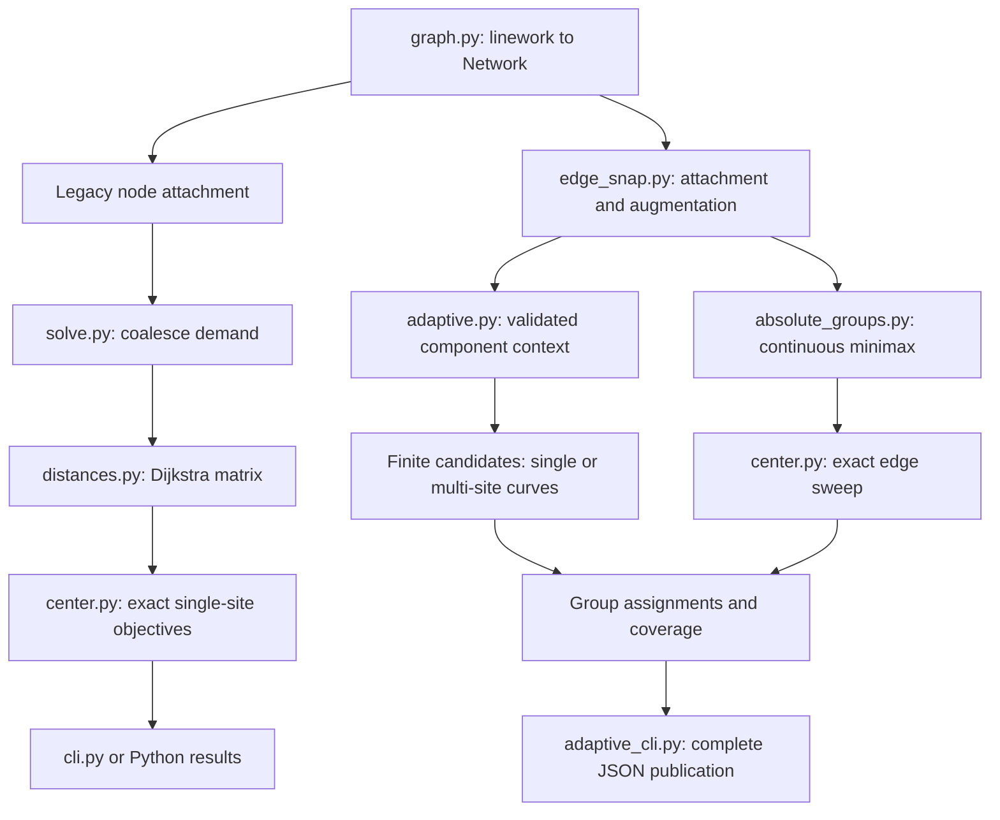

# Architecture

The numerical implementation is deliberately separated from GIS, routing and publication. Two interfaces coexist; the adaptive workflow does not replace the original one.

## Execution paths

A numerical caller may bypass GIS and supply a symmetric positive-weight CSR graph directly to `solve_adaptive` or `solve_groups`, or a distance matrix to the original mathematical core.

## Shared foundations

- `topology.py`: numeric adjacency construction; minimum length across parallel connections, not summed duplicates.
- `graph.py`: projected CRS, line cleanup, source-vertex junctions, optional planar noding, ring protection, transitive coordinate merging, graph compaction and optional largest-component retention. Physical edges remain distinct even if routing adjacency collapses parallel pairs.
- `_checks.py`: input checks used by original numeric entry points.
- `distances.py`: original bounded Dijkstra blocks, optional parallel scheduling and float32 storage, memory estimates and assembly of a persistent demand-by-node matrix.
- `center.py`: original weighted median, vertex center and exact absolute-center edge sweep; lower bounds prune candidate edges. Does not import GIS libraries.

## Legacy orchestration

`solve.py` consolidates repeated demand nodes, builds the distance matrix, invokes the original solvers and attaches map coordinates. `cli.py` handles GIS input, nearest-node demand, largest-component construction, progress and optional point output. Its public API and console entry point remain unchanged.

## Adaptive orchestration

`edge_snap.py` validates ordered physical geometry, edge lengths and CSR consistency. It projects demand and candidate points to edges and builds an augmented network with original edge IDs and start measures. Interior insertions preserve original routing distances within numerical tolerance. The original network is not mutated. Geometry operations use optional Shapely.

`adaptive.py` is GIS-independent. `RoutingContext` validates the symmetric CSR and caches component subgraphs. `solve_adaptive` handles one group, component policies, demand coalescing, candidate sets, streaming single-site reductions and finite-candidate dense multi-site curves. BUILD/SWAP and exact enumeration are alternative curve engines; a dynamic program allocates a site budget across component curves. Selection and routing verification follow. `solve_groups` reuses one context and returns original row indices plus results for each group; group-specific vertex universes avoid cross-group candidate contamination. Numerical callers supplying physical lengths must provide valid provenance for longer parallel edges that cannot be inferred from collapsed CSR.

`absolute_groups.py` validates actual physical geometry, builds component distance matrices and delegates the continuous minimax objective to `center.absolute_center`. Duplicate offsets are combined by maximum when included in the radius. It returns explicit node/edge location records and recomputed routed access diagnostics. It does not implement general k-center.

`adaptive_cli.py` handles input CRS, point and candidate layers, snapping/coverage audits, group orchestration, option validation and JSON serialization. All groups must succeed before no-clobber publication via hard link. The output schema is `net-center-adaptive/5`; the configured versus executed finite-site solver diagnostics are distinct. It does not modify input files or invent connections.

## Memory and dependencies

The original numerical core and adaptive finite-site solver use NumPy/SciPy; the original parallel path also uses Joblib. GIS dependencies are optional. Legacy matrices and adaptive multi-site matrices have different controls. Streaming adaptive single-site solves still retain the graph, cached subgraphs and at least one shortest-path row. Dense and exact-enumeration gates are not process-RSS guarantees. General directed costs, graph contraction and target-terminated routing are outside the current architecture.

See [Network assumptions](NETWORK_ASSUMPTIONS.md), [Algorithms](ALGORITHMS.md), [Adaptive location](ADAPTIVE_LOCATION.md) and [Validation](VALIDATION.md).
